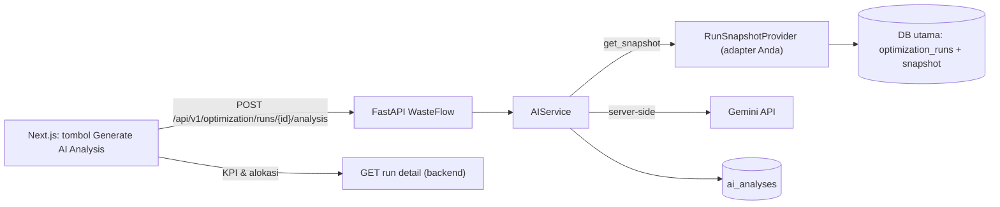

# Integrasi AI Intelligence Layer ke Sistem WasteFlow

Dokumen ini menjelaskan cara memasang modul AI ke backend FastAPI utama WasteFlow dan frontend Next.js.

## 0. Gambaran



Satu-satunya titik sambung yang **wajib** Anda tulis adalah **`RunSnapshotProvider`** (lihat `app/integration/run_provider.py`). Modul AI tidak membaca database utama secara langsung (Spec 1.3). Modul ini hanya meminta snapshot run yang immutable.

---

## 1. Mode yang disarankan: embedded (satu backend)

Technical Blueprint menetapkan bahwa AI adalah modul di dalam backend FastAPI. Karena itu, salin folder-folder ini ke repo backend utama:

```text
app/ai/                       (seluruh folder)
app/services/ai_service.py
app/api/v1/ai.py
app/integration/run_provider.py
app/models/ai_analysis.py
```

`app/models/optimization_run.py` dan `app/api/v1/runs.py` **tidak perlu** disalin. Keduanya hanya untuk mode standalone/dev.

### 1.1 Tulis adapter snapshot

Snapshot sebaiknya dibuat **saat solver selesai** lalu disimpan apa adanya, misalnya di kolom JSON `snapshot` pada tabel run. Dengan begitu, analisis AI selalu memakai angka yang sama dengan yang dilihat pengguna.

```python
# app/integration/wasteflow_provider.py
from typing import Optional
from fastapi import Depends
from sqlalchemy.orm import Session
from app.core.database import get_db
from app.integration.run_provider import RunSnapshot
from app.models.run import OptimizationRun          # model milik sistem utama

class WasteFlowRunProvider:
    def __init__(self, db: Session):
        self.db = db

    def get_snapshot(self, run_id: str) -> Optional[RunSnapshot]:
        run = self.db.get(OptimizationRun, run_id)
        if run is None or run.snapshot is None:
            return None
        snap = dict(run.snapshot)                     # sudah berbentuk Spec 3.2
        snap["run_id"] = str(run.id)
        return RunSnapshot(run_id=str(run.id),
                           solver_status=run.solver_status,   # mis. "Optimal" dari pulp.LpStatus
                           snapshot=snap,
                           owner_id=str(run.created_by))

    def can_access(self, run: RunSnapshot, user_id: Optional[str]) -> bool:
        return user_id is not None and run.owner_id == user_id   # sesuaikan dengan aturan role Anda

def get_wasteflow_provider(db: Session = Depends(get_db)):
    return WasteFlowRunProvider(db)
```

### 1.2 Bentuk snapshot dari hasil PuLP

```python
import pulp

def build_snapshot(run, prob, x, routes, materials, kpi, baseline_kpi, flags) -> dict:
    return {
        "batch_id": str(run.batch_id),
        "facility": {"facility_id": str(run.facility_id), "facility_name": run.facility.name},
        "data_source": run.data_source,                         # "synthetic" | "field"
        "period": {"start": run.period_start.isoformat(), "end": run.period_end.isoformat(),
                   "capacity_period": "day"},
        "solver": {"status": pulp.LpStatus[prob.status], "name": "PuLP", "version": pulp.__version__},
        "weights": {"cost": run.w_cost, "recovery": run.w_recovery, "residual": run.w_residual},
        "metrics": kpi,                                         # dihitung backend, bukan AI
        "routes": [{"route_id": r.id, "route_name": r.name, "allocated_kg": r.allocated,
                    "capacity_kg": r.capacity, "utilization_rate": r.allocated / r.capacity}
                   for r in routes],
        "allocations": [{"material_id": m.id, "material_name": m.name, "route_id": r.id,
                         "allocated_kg": x[m.id, r.id].value()}
                        for m in materials for r in routes if (x[m.id, r.id].value() or 0) > 0],
        "baseline_metrics": baseline_kpi,                       # None jika baseline gagal
        "validation": {"mass_balance_error_kg": ..., "capacity_violations": ...,
                       "compatibility_violations": ...},
        # hint data quality (opsional):
        "is_yield_assumed": flags.yield_assumed,
        "has_missing_routes": flags.missing_route_profile,
        "is_period_mismatched": flags.period_mismatch,
    }
```

Status PuLP (`Optimal`, `Not Solved`, `Infeasible`, `Unbounded`, `Undefined`) sudah dikenali oleh `validator.check_eligibility`. Jika adapter Anda memakai nama status lain, tambahkan di sana (Spec 2.3).

### 1.3 Daftarkan router, adapter, dan auth

```python
# app/main.py (backend utama)
from app.api.v1 import ai as ai_router
from app.integration.run_provider import get_run_provider, get_current_user
from app.integration.wasteflow_provider import get_wasteflow_provider
from app.auth import current_user_id            # dependency auth milik sistem utama

app.include_router(ai_router.router, prefix="/api/v1")
app.dependency_overrides[get_run_provider] = get_wasteflow_provider
app.dependency_overrides[get_current_user] = current_user_id
```

### 1.4 Migrasi tabel `ai_analyses`

Jika sistem utama memakai Alembic, import `app.models.ai_analysis` di `env.py` lalu jalankan:

```bash
alembic revision --autogenerate -m "add ai_analyses"
alembic upgrade head
```

Hapus juga `Base.metadata.create_all(...)` dari startup produksi.

### 1.5 Environment produksi

```env
GEMINI_API_KEY=...            # hanya di server, tanpa NEXT_PUBLIC_
GEMINI_MODEL=gemini-3.8-flash
AI_ALLOW_MOCK=false
ENABLE_DEV_ENDPOINTS=false
CORS_ORIGINS=https://wasteflow.example.com
```

---

## 2. Alternatif: mode sidecar (service terpisah)

Pakai mode ini jika backend utama tidak bisa diubah. Jalankan service ini apa adanya, lalu ganti provider dengan versi yang mengambil snapshot lewat HTTP:

```python
import httpx
class HttpRunProvider:
    def __init__(self, base_url: str, token: str):
        self.c = httpx.Client(base_url=base_url, headers={"Authorization": f"Bearer {token}"}, timeout=10)
    def get_snapshot(self, run_id):
        r = self.c.get(f"/api/v1/optimization/runs/{run_id}/snapshot")
        if r.status_code == 404:
            return None
        r.raise_for_status()
        d = r.json()
        return RunSnapshot(run_id=run_id, solver_status=d["solver"]["status"], snapshot=d)
    def can_access(self, run, user_id):
        return True   # otorisasi sudah dilakukan backend utama
```

Konsekuensinya ada dua service yang harus di-deploy. Selain itu, frontend harus tetap memanggil backend utama yang kemudian meneruskan request ke sidecar, supaya auth tetap di satu tempat.

---

## 3. Frontend Next.js

Aturan dari spec yang wajib dipegang:
- KPI dan alokasi **selalu** diambil dari endpoint run backend, tidak pernah dari teks AI (Spec 4.3, 9.4).
- Analisis AI hanya dibuat saat pengguna menekan tombol (Spec 1.4).
- Jika AI gagal, halaman hasil optimasi tetap tampil normal (Spec 8).

```ts
// lib/ai.ts
export type AIError = { code: string; layer: string; message: string;
  analysis_id?: string; retryable: boolean; details?: unknown };

export async function generateAnalysis(runId: string) {
  const res = await fetch(`${process.env.NEXT_PUBLIC_API_URL}/api/v1/optimization/runs/${runId}/analysis`, {
    method: "POST",
    headers: { "Content-Type": "application/json" },
    credentials: "include",
    body: JSON.stringify({ analysis_type: "full" }),
  });
  const body = await res.json();
  if (!res.ok) throw body.error as AIError;
  return body; // { analysis_id, status, model, prompt_version, result, ... }
}
```

```tsx
// components/AIInsightsCard.tsx (inti logika state)
"use client";
import { useState } from "react";
import { generateAnalysis, AIError } from "@/lib/ai";

export function AIInsightsCard({ runId }: { runId: string }) {
  const [state, setState] = useState<"idle" | "loading" | "done" | "error">("idle");
  const [data, setData] = useState<any>(null);
  const [err, setErr] = useState<AIError | null>(null);

  const run = async () => {
    setState("loading"); setErr(null);
    try { setData(await generateAnalysis(runId)); setState("done"); }
    catch (e) { setErr(e as AIError); setState("error"); }
  };

  if (state === "idle") return <button onClick={run}>Generate AI Analysis</button>;
  if (state === "loading") return <p>Menganalisis hasil optimasi…</p>;
  if (state === "error") return (
    <div role="alert">
      <p>{messageFor(err!)}</p>
      {err!.retryable && <button onClick={run}>Retry</button>}
      {err!.code === "DUPLICATE_REQUEST" && err!.analysis_id &&
        <a href={`/ai/analyses/${err!.analysis_id}`}>Lihat analisis terakhir</a>}
    </div>
  );

  const r = data.result;
  return (
    <section aria-label="AI Insights">
      <small>AI ({data.model}, {data.prompt_version}). Interpretasi, bukan sumber angka KPI.</small>
      <p>{r.summary}</p>
      {r.operational_insights.map((i: any) => (
        <article key={i.title}><b>[{i.severity}] {i.title}</b><p>{i.finding}</p>
          <EvidenceChips keys={i.evidence} /></article>))}
      {r.recommendations.map((x: any) => (
        <article key={x.action}><b>[{x.priority}] {x.action}</b><p>{x.rationale}</p>
          <EvidenceChips keys={x.evidence} /></article>))}
      <ul>{r.limitations.map((l: string) => <li key={l}>{l}</li>)}</ul>
    </section>
  );
}

function messageFor(e: AIError) {
  switch (e.code) {
    case "RUN_NOT_ELIGIBLE":  return e.message;   // alasan solver dari backend
    case "PAYLOAD_NOT_READY": return "Data run belum lengkap untuk dianalisis.";
    case "AI_RATE_LIMITED":   return "Batas permintaan AI tercapai. Hasil optimasi tetap tersedia.";
    case "AI_UNAVAILABLE":
    case "AI_TIMEOUT":        return "AI sedang tidak tersedia. Silakan coba lagi.";
    case "AI_OUTPUT_INVALID": return "Analisis AI gagal validasi dan tidak ditampilkan.";
    case "DUPLICATE_REQUEST": return "Analisis untuk run ini baru saja dibuat.";
    default:                  return "Analisis AI gagal.";
  }
}
```

`EvidenceChips` dapat memetakan key seperti `route_utilization:route-1` ke label/nilai yang diambil dari data run **backend**. Dengan cara itu pengguna bisa menelusuri bukti tanpa angka dari AI.

---

## 4. Kontrak error (untuk UI)

| HTTP | `error.code` | Arti | Gemini dipanggil? | Tersimpan di history? |
|---|---|---|---|---|
| 404 | RUN_NOT_FOUND | Run tidak ada / tidak boleh diakses | Tidak | Tidak |
| 422 | RUN_NOT_ELIGIBLE | infeasible/unbounded/error | Tidak | Tidak |
| 422 | PAYLOAD_NOT_READY | data kurang / period_mismatch / bobot ≠ 1 | Tidak | Ya (failed) |
| 429 | DUPLICATE_REQUEST | cooldown per run | Tidak | Tidak |
| 429 | AI_RATE_LIMITED | kuota Gemini | Ya | Ya (failed) |
| 503 | AI_UNAVAILABLE / AI_TIMEOUT / AI_NOT_CONFIGURED | provider bermasalah | Ya/Tidak | Ya (failed) |
| 502 | AI_OUTPUT_INVALID | output ditolak di layer 3–6 setelah retry korektif | Ya | Ya (invalid, `result` = null) |
